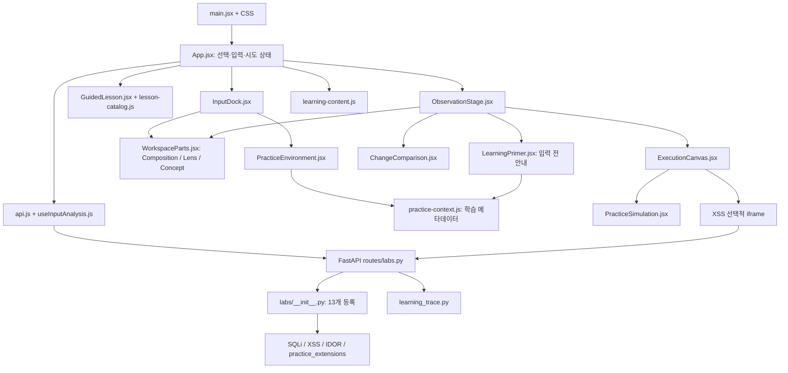

# 현재 저장소 구조와 참조 관계

연결: [통합 학습 공간 승인 범위](../decisions/2026-10-23-unified-workspace.md), [구현 검증 기록](../decisions/2026-10-23-implementation-review.md)

2026-10-23 통합 작업의 소스 조사입니다. 현재 저장소에는 실행 코드와 문서가 함께 있습니다. 과거 문서에 있는 별도 구현 저장소·브랜치·PR 설명은 당시의 경위로 보존합니다.

## 디렉터리별 책임

```text
-PayloadLab-/
├── README.md                         # 처음 실행·학습 범위
├── docker-compose.yml                # 로컬 frontend/backend 연결
├── .dockerignore                     # 루트 빌드 문맥의 생성물·로컬 파일 제외
├── .github/ISSUE_TEMPLATE/            # 팀 이슈 양식
├── backend/
│   ├── Dockerfile, .dockerignore
│   ├── requirements.txt              # 런타임 의존성
│   ├── requirements-dev.txt          # pytest 포함
│   ├── app/
│   │   ├── main.py                   # FastAPI·CORS·/health
│   │   ├── routes/labs.py            # /labs 목록·analyze·attempt·render
│   │   ├── core/lab.py               # 랩 메타데이터·결과·Lens 계약
│   │   ├── learning_trace.py         # 입력/결과 근거·제한된 설명 모형
│   │   └── labs/                     # 랩 등록 및 유형별 판정·순수 모형
│   └── tests/
├── frontend/
│   ├── Dockerfile, .dockerignore
│   ├── package.json, pnpm-lock.yaml, pnpm-workspace.yaml
│   ├── index.html, vite.config.js
│   ├── public/brand/                 # UI와 README가 함께 쓰는 승인된 문자 브랜드 SVG
│   └── src/                          # 화면·교육 메타데이터·테스트
├── scripts/verify_local_compose.py    # 실행 중인 로컬 Compose HTTP 검사
└── docs/
    ├── architecture/                 # 이 구조와 참조 근거
    ├── branding/                     # 기존 브랜드·원본 자산 확인
    ├── deployment/                   # 현재 안전/보관 경계·검토 초안
    ├── planning/, research/          # 기획·조사
    ├── decisions/, meeting-notes/    # 결정·검증·회의·보고 원본
    └── datasets/payloads-all-the-things/
        ├── *.csv, curated_samples.py # 문자열 참고 데이터·선별 메타데이터
        ├── sources/, manifest.json  # 고정 원문·바이트/해시 출처
        ├── build_dataset.py, test_dataset.py
        └── LICENSE, .gitattributes   # 라이선스·바이트 보존
```

폴더 분리 원칙은 현재 책임을 설명하는 기준입니다. 이번 작업에서 전체 폴더를 옮기거나 대규모 이름 변경을 하지 않습니다. `docs/meeting-notes/`의 DOCX와 자료 원문도 보존 대상입니다.

## 현재 화면·API 참조 그래프

아래는 런타임 진입점의 import와 API 호출을 따라간 요약입니다.



`App`이 입력·처리·Lens를 하나의 `통합 학습 작업 공간`으로 렌더링하고, `InputDock`의 입력·안내와 `ObservationStage`의 처리·결과를 배치합니다. `practice-context.js`는 설명·학습 목표용 순수 메타데이터이며 실행 판정은 백엔드 응답을 사용합니다. `main.jsx`는 기존 3개 CSS와 `theme-tokens.css`, `unified-workspace.css`를 불러옵니다. 새 CSS는 의미별 색상과 통합 배치를 담당합니다.

| 요청 | 현재 책임 |
| --- | --- |
| `GET /health` | API 상태 응답. 종합 검증 아님 |
| `GET /labs`, `GET /labs/{id}` | 등록된 랩과 메타데이터 |
| `POST /labs/{id}/analyze` | 입력 분석. SQL은 `EXPLAIN`으로 컴파일 확인하며 실행 결과와 분리 |
| `POST /labs/{id}/attempt` | 랩 판정과 학습 추적. SQLi는 실제 SQLite 조회, 확장 실습은 제한된 모형 |
| `GET /labs/{id}/render` | XSS 원본 HTML 문서. 프론트엔드의 결과 열기에서 사용 |

IDOR의 고정 사용자와 권한상승의 가상 사용자는 실제 로그인 세션이 아닙니다. 확장 실습의 `history`는 클라이언트가 보내고 매번 새 가상 상태에 재생합니다. [상태·보관 근거](../deployment/local-safety-and-retention.md)를 함께 보세요.

## 구형 UI 정리 후보

기준은 `src/main.jsx → App.jsx`에서 도달 가능한 import 그래프와 `rg` 참조 조사입니다. 파일이 남아 있다는 이유만으로 삭제 대상으로 확정하지 않습니다.

| 후보 | 현재 조사 결과 | 후속 확인 |
| --- | --- | --- |
| `Sidebar.jsx`, `LensInput.jsx` | 현재 런타임의 다른 모듈에서 import하지 않음 | 이전 UI 요구·재사용 의도 확인 |
| `AttemptResultView.jsx` | 현재 진입점에서 도달하지 않음. 내부에 과거 API 기본 주소 `localhost:8000` 잔존 | 현행 `ExecutionCanvas`와 역할 비교 |
| `AttemptFlowView.jsx → CodeView.jsx / FlowGraph.jsx` | 위 구형 결과 화면 내부 연결. 현재 App에서 도달하지 않음 | 별도 테스트·문서·외부 사용 여부 확인 |
| `WorkspaceParts.jsx`의 `HistoryPanel` | 모듈의 다른 export는 사용 중이나 이 export의 소비자는 찾지 못함 | 파일 전체 삭제 금지, export 단위 검토 |
| `index.css` | 현재 `main.jsx`에서 import하지 않음 | 사용 중인 기존 3개 CSS와 `theme-tokens.css`, `unified-workspace.css`와 구분 |

후속 이동·삭제 전에 해당 후보의 테스트·동적 로딩·문서 참조를 다시 검색하고, 브라우저 회귀를 확인한 뒤 별도 변경으로 검토합니다. 이번에는 이름 변경·이동·삭제를 수행하지 않습니다.

## 소스·생성물·로컬 도구 파일

| 구분 | 예 | 처리 기준 |
| --- | --- | --- |
| 보존하는 소스·근거 | `src/`, `app/`, 테스트, Dockerfile, lockfile, `sources/`, `manifest.json`, LICENSE | 개발·재현에 필요한 원본. 빌드 제외 규칙으로 광범위하게 차단하지 않음 |
| 재생성 가능한 결과 | `frontend/dist/`, `node_modules/`, `.pytest_cache/`, `__pycache__/`, `*.pyc`, coverage | Git 추적·이미지 복사 대상에서 제외. 기존 추적 여부는 별도로 확인 |
| 로컬 도구·설정 | `.codex/`, `.agents/`, `.claude/`, `.worktrees/`, `.env*` | 앱 실행에 필요한 소스와 구분하고 이미지에 복사하지 않음. 실제 내용 확인 없이 삭제하지 않음 |
| Git 내부 상태 | `.git` 디렉터리 또는 worktree 연결 파일 | 원본 이력·연결 유지. 이미지에 복사하지 않으며 일반 정리 작업으로 삭제하지 않음 |

시작 커밋 `232ae67`의 파일 목록에는 `frontend/dist/`와 `backend/**/__pycache__/*.pyc`가 추적되어 있었습니다. 이번 통합 작업의 변경에는 이 생성물의 Git 추적 해제가 포함됩니다. 로컬 생성물 파일은 삭제하지 않고 보존했으며, `.gitignore`로 다시 추적되는 것을 막습니다. 추적 해제는 로컬 파일 삭제와 다르며, 원본 코드·데이터 manifest·Git 이력은 보존합니다.

이 작업 대상 저장소의 숨김 파일을 조사했을 때 `.codex/`, `.agents/`, `.claude/` 내용은 없었습니다. 상위 로컬 작업 공간의 빈 도구 폴더와 `.worktrees/`는 이 앱의 필수 파일이 아닙니다. 다른 checkout·사용자 폴더에 도구 설정이 없다는 뜻은 아닙니다.

Compose는 `./frontend`, `./backend`를 각각 빌드 문맥으로 사용하므로 하위 `.dockerignore`가 실제 각 이미지에 적용됩니다. 루트 `.dockerignore`는 루트를 빌드 문맥으로 사용하는 경우를 위한 규칙입니다. Docker ignore는 호스트 파일이나 Git 추적 상태를 삭제하지 않습니다.

이 구분은 Docker의 [빌드 문맥과 .dockerignore 설명](https://docs.docker.com/build/concepts/context/#dockerignore-files)을 근거로 했습니다. 제외 파일 위치·적용 범위를 확인하기 위해 참고했으며, 실제 이미지 내용은 Docker 빌드 후 별도로 검사해야 합니다.

## 확인 근거와 한계

현재 파일 목록, `main.jsx`·`App.jsx` import, 백엔드 registry·routes·상태 코드를 읽고 작성했습니다. 브라우저 전체 동작, Docker 빌드·실행, 외부 접근 차단은 이 조사만으로 확인되지 않습니다. 실행 명령은 [README](../../README.md), 공개 전 확인은 [검토 초안](../deployment/security-review-issue-draft.md)에 있습니다.
